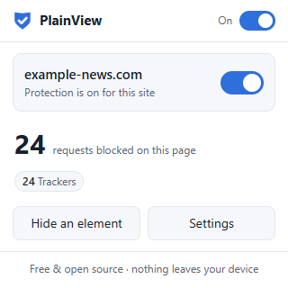
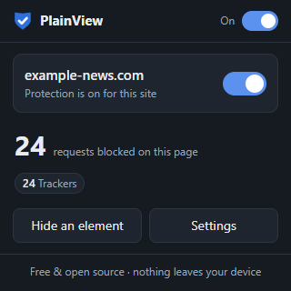

# PlainView Ad Blocker

**A free, open-source ad, tracker and cookie-banner blocker for Chrome, Edge, Brave and Firefox.**
No accounts. No telemetry. No "acceptable ads" deals. No network requests of its own.

<p>
  
  
</p>

PlainView is part of the [Free Tools Ecosystem](https://github.com/Sushang-Agnihotri/free-tools-ecosystem), a set of small, privacy-first utilities that are free forever.

## Features

- **Blocks ads, trackers and malware hosts** using the browser's own built-in blocking engine (`declarativeNetRequest`). No script runs for each request, so blocking doesn't slow pages down.
- **Hides leftover ad slots and cookie banners** (element hiding). Only the hiding rules that can match the current page are applied.
- **Closes pop-up ads** opened to known pop-up ad domains.
- **One-click allowlist:** turn PlainView off for any site from the toolbar popup.
- **Pause everywhere** with one switch.
- **Per-page statistics:** the badge and popup show how many requests were blocked on the current page, grouped by list.
- **Hide any element yourself:** click *Hide an element*, then click the thing you want gone. The rule is saved and can be removed later.
- **Custom filters** in standard Adblock Plus syntax (block domains, hide elements, add exceptions).
- **Choose your lists:** Ads, Trackers, Cookie banners and Malicious sites can each be turned on or off.
- **Backup and restore** settings to a JSON file.
- Light and dark mode, keyboard accessible.

### Filter lists included

| List | Purpose | Source |
|---|---|---|
| Ads | Display, video and pop-up advertising | [EasyList](https://easylist.to/) |
| Trackers | Analytics, tracking pixels, fingerprinting | [EasyPrivacy](https://easylist.to/) |
| Cookie banners | Hides consent pop-ups (does **not** click accept or reject) | [EasyList Cookie List](https://easylist.to/) |
| Malicious sites | Hosts currently spreading malware | [URLhaus](https://urlhaus.abuse.ch/) via [malware-filter](https://gitlab.com/malware-filter/urlhaus-filter) |

The lists are compiled into the extension when it's built. A scheduled GitHub Action rebuilds them weekly and publishes a new release.

## Install

### Chrome, Edge, Brave, Opera, Vivaldi

PlainView isn't in the browser stores yet. Until it is, you can install it in about a minute:

1. Download `plainview-adblock-<version>-chromium.zip` from the [latest release](https://github.com/Sushang-Agnihotri/plainview-adblock/releases/latest).
2. Unzip it to a folder you'll keep, for example `Documents\PlainView`.
3. Open the extensions page: `chrome://extensions` (Chrome and Brave) or `edge://extensions` (Edge).
4. Turn on **Developer mode** (top-right in Chrome, left sidebar in Edge).
5. Click **Load unpacked** and select the unzipped folder.
6. Optional: pin PlainView to the toolbar from the puzzle-piece menu.

To update, download the new zip, replace the folder's contents, and click the reload icon on the PlainView card.

### Firefox (experimental)

1. Download `plainview-adblock-<version>-firefox.zip` from the [latest release](https://github.com/Sushang-Agnihotri/plainview-adblock/releases/latest).
2. Open `about:debugging#/runtime/this-firefox` and click **Load Temporary Add-on…**, then select the zip.
3. Click the PlainView toolbar button and choose **Allow on all websites** so it can hide ad slots and banners.

Firefox removes temporary add-ons when it restarts. A permanent, signed version will be published on addons.mozilla.org.

### Requirements

- Chrome, Edge or Brave 120 or newer (any Chromium browser with Manifest V3)
- Firefox 128 or newer
- Windows 10/11, macOS or Linux

## Privacy

PlainView doesn't collect, store or send any data about you. It has no servers and no analytics, and it never makes network requests of its own. Your settings stay in your browser's local storage. Full policy: [PRIVACY.md](PRIVACY.md).

### Why each permission is needed

| Permission | Why |
|---|---|
| `declarativeNetRequest` | Lets the browser block requests using PlainView's rules |
| Access to all websites | Hide empty ad slots and cookie banners on the pages you visit |
| `scripting` | Apply element-hiding styles and start the element picker when you ask for it |
| `webNavigation` | Know when a page starts loading so the right hiding rules are applied, and spot pop-up ads |
| `storage` | Save your settings locally |
| `activeTab` | Show the blocked-request count for the tab you're looking at |

## Limitations

No blocker stops every ad, and PlainView isn't an exception:

- **YouTube and similar sites** serve ads from the same servers as the videos and change how they deliver them often. In-video ads may still play. (For sponsor segments *inside* videos, see our separate YouTube Sponsor Skipper, coming next.)
- **Manifest V3 rules are fixed at build time.** Filter lists update when PlainView updates (weekly releases), not continuously.
- **Advanced filter syntax isn't supported:** scriptlets (`##+js`), procedural selectors (`:has-text`, `:-abp-contains`), `$redirect`, `$removeparam` and `$csp` rules are skipped. That's under 1% of the rules in each list (0.8% of EasyList).
- **Firefox:** blocking and hiding work, but Firefox doesn't report blocked-request counts to extensions, so the counter isn't shown there.
- **Cookie banners are hidden, not answered.** A few sites lock scrolling until you choose. If that happens, turn PlainView off for that site, or untick *Cookie banners*.

## Performance

Measured with the automated test suite (`npm run test:e2e`, Chrome 156, Windows 11):

| | Without PlainView | With PlainView |
|---|---|---|
| Local test page with 3,000 elements and 40 tracker requests (median load) | 46 ms | 52 ms |
| Background service worker memory while active | — | 13.5 MB (unloaded by the browser when idle) |
| Static blocking rules | — | 14,701 (Chrome guarantees 30,000) |

On real websites, blocking ad and tracker requests usually makes pages load *faster* than without a blocker, because those requests never download. The test above runs on a local server where requests cost almost nothing, so it shows PlainView's overhead and not its savings.

## Troubleshooting

**A site looks broken or won't load.** Click the PlainView icon, switch off *Protection on this site* and reload. Please [open an issue](https://github.com/Sushang-Agnihotri/plainview-adblock/issues) with the site address so we can fix the rule.

**I hid the wrong element.** Open *Settings → Custom filters*, delete the line that starts with the site's name, and click *Save filters*.

**The badge shows nothing.** The number appears once something on the page is blocked. If PlainView is paused, the badge reads `off`.

**"Load unpacked" shows an error.** Make sure you selected the folder that contains `manifest.json`, not the zip file or a parent folder.

## Uninstall

Open `chrome://extensions` (or `edge://extensions`, or Firefox's Add-ons page), find PlainView and click **Remove**. All of its settings are deleted with it.

## Build from source

You need [Node.js](https://nodejs.org/) 20 or newer.

```bash
npm install            # installs the test tools (puppeteer-core)
npm run fetch-lists    # downloads the current filter lists
npm run build          # compiles rules → build/chromium, build/firefox, dist/*.zip
npm test               # unit tests
npm run test:e2e       # end-to-end tests in your installed Chrome or Edge
```

The extension has no runtime dependencies. `puppeteer-core` is only used for testing.

### How it works

```
filters/lists.json ─► scripts/fetch-lists.mjs ─► filters/raw/*.txt
                                                      │
                     src/lib/abp.js (Adblock Plus → declarativeNetRequest converter)
                                                      │
                   ┌──────────────────────────────────┼──────────────────────────────┐
           rulesets/*.json                  cosmetic/*.json                cosmetic/*.generic.css
     (network rules, enforced by       (site-specific + on-demand           (small always-on
      the browser itself)               element hiding index)                hiding sheet)
```

- `src/background.js` switches rulesets on and off, keeps the allowlist rule current, injects element-hiding CSS, and closes pop-up ads.
- `src/content/collector.js` reports which class and id names exist on a page (never text or form data) so only matching hiding rules are injected.
- `src/popup`, `src/options` and `src/picker` are the user interface.

## Contributing

Bug reports and pull requests are welcome. Please run `npm test` and `npm run test:e2e` before opening a pull request.

## License

PlainView's code is released under the [MIT License](LICENSE). The bundled filter lists keep their own licenses. See [NOTICE.md](NOTICE.md).
